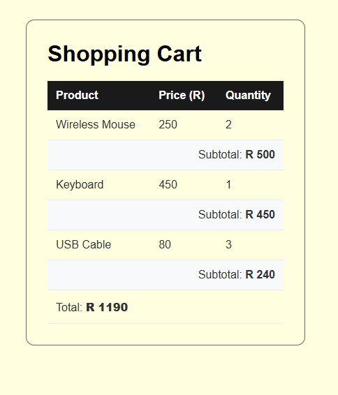

# Shopping Cart 

A shopping cart built with HTML, CSS, and JavaScript that displays product information, calculates individual product subtotals, and determines the total cart cost.

## Features

- Displays three products with their prices and quantities.
- Calculates each product's subtotal using price and quantity.
- Calculates the total cost of all products.
- Updates the page using JavaScript DOM manipulation.
- Presents the information in a styled HTML table.

## Technologies

- HTML5
- CSS3
- JavaScript

## Demo

## Key Concepts Practiced

- Declaring variables with `const`
- Working with numbers and strings
- Performing arithmetic operations
- Calculating subtotals and totals
- Selecting HTML elements with `document.querySelector()`
- Updating page content with `textContent`
- Using template literals to display currency
- Structuring data in an HTML table
- Styling tables with CSS

## Expected Results

| Product | Price | Quantity | Subtotal |
|---|---:|---:|---:|
| Wireless Mouse | R250 | 2 | R500 |
| Keyboard | R450 | 1 | R450 |
| USB Cable | R80 | 3 | R240 |
| **Cart Total** | | | **R1,190** |

## How to Run

1. Clone or download this repository.
2. Open the project folder.
3. Open `index.html` in a web browser.
4. View the shopping cart and its calculated totals.

## Learning Outcome

This project demonstrates how JavaScript variables and arithmetic operations can represent real shopping-cart data, calculate values, and display the results in an HTML document.